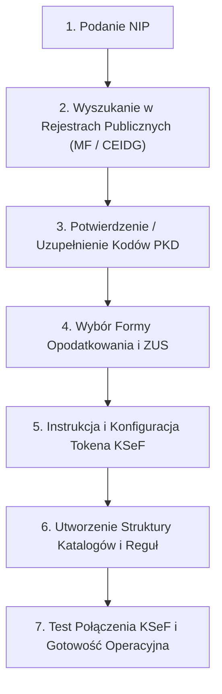

# Procedura Inicjalizacji Nowej Firmy (Onboarding Podatnika)

Ten skill służy do przeprowadzenia przedsiębiorcy przez kompletny proces wdrożenia i założenia profilu firmy w **TaxPilot AI**.
Gwarantuje, że profil firmy (`profil.json`), kody PKD, parametry ZUS, środowisko KSeF oraz reguły podatkowe zostaną skonfigurowane poprawnie od pierwszego dnia.

---

## Przebieg Procesu Krok po Kroku



---

### Krok 1: Zapytanie o NIP i Auto-Pobranie Danych Rejestrowych

Agent prosi użytkownika o podanie 10-cyfrowego numeru NIP jego działalności.

Po otrzymaniu NIP, agent automatycznie odpytuje rejestry publiczne:
1. **Biała Lista Podatników VAT (Ministerstwo Finansów):**
   * Endpoint: `https://wl-api.mf.gov.pl/api/search/nip/{NIP}?date={YYYY-MM-DD}`
   * **Zaleta:** Publiczne, oficjalne API MF, **nie wymaga żadnych kluczy ani rejestracji**.
   * **Pobrane dane:** Pełna oficjalna nazwa firmy, adres rejestrowy/siedziba, numer REGON, status podatnika VAT (Czynny / Zwolniony).
2. **Hurtownia Danych CEIDG (dane.biznes.gov.pl):**
   * Oficjalne API Ministerstwa Rozwoju i Technologii dla JDG.
   * Jeśli w środowisku skonfigurowany jest darmowy klucz API (`CEIDG_API_TOKEN`), system pobiera z CEIDG pełną listę kodów PKD.

Wywołanie narzędzia w CLI:
```bash
python -m src.cli init-firma --nip {NIP}
```

---

### Krok 2: Rejestracja Kodów PKD i Wyjaśnienie Ich Znaczenia Podatkowego

Jeśli kody PKD nie zostały pobrane automatycznie z CEIDG, agent prosi użytkownika o ich podanie (lub potwierdzenie):
> *"W Twoim profilu rejestrujemy kody PKD Twojej działalności (np. `62.01.Z`, `62.02.Z` dla IT). Podaj proszę swoje kody lub branżę."*

#### Dlaczego kody PKD w `profil.json` są kluczowe?
* **Obrona Podatkowa Kosztów (art. 22 ust. 1 ustawy o PIT):** Kosztem uzyskania przychodów są wydatki poniesione w celu osiągnięcia przychodów lub zabezpieczenia ich źródła.
* **Zero-Hallucination w Klasyfikacji:** Mając zarejestrowane kody PKD (np. działalność programistyczna), agent wie, że zakup licencji JetBrains, serwerów w chmurze AWS/GCP, monitorów czy ergonomicznego fotela jest w 100% uzasadniony gospodarczo i nie wymaga kłopotliwych pytań do użytkownika. Z kolei nietypowe wydatki (np. materiały budowlane) zostaną natychmiast skierowane do wyjaśnienia.

---

### Krok 3: Wybór Formy Opodatkowania i Parametrów ZUS

Agent weryfikuje z przedsiębiorcą formę opodatkowania oraz schemat opłacania składek ZUS:

1. **Forma Opodatkowania:**
   * **Ryczałt od przychodów ewidencjonowanych** (najczęstszy dla IT i usług B2B) – agent pyta o domyślną stawkę (np. **12%** dla programistów i architektów IT, **8.5%** dla usług ogólnych, **15%**).
   * **Podatek Liniowy 19%** (stała stawka podatku od dochodu).
   * **Skala Podatkowa 12% / 32%** (kwota wolna 30 000 zł, drugi próg od 120 000 zł).
2. **Schemat Składek ZUS:**
   * **Pełny ZUS (Duży ZUS):** Standardowy po okresie preferencji.
   * **Mały ZUS Plus / Preferencyjny:** Obniżona podstawa wymiaru składek społecznych.
   * **Ulga na Start:** 0 zł składek społecznych (opłacana wyłącznie składka zdrowotna przez pierwsze 6 miesięcy).
3. **Dobrowolne Ubezpieczenie Chorobowe:**
   * Czy przedsiębiorca zgłosił się do ubezpieczenia chorobowego (prawo do zasiłku chorobowego i macierzyńskiego). Domyślnie: `TAK`.

---

### Krok 4: Instrukcja Generowania i Przekazania Tokena KSeF 2.0

Agent przedstawia przedsiębiorcy precyzyjną, oficjalną instrukcję wygenerowania **Tokena KSeF 2.0** w Aplikacji Podatnika Ministerstwa Finansów:

```text
┌────────────────────────────────────────────────────────────────────────┐
│  INSTRUKCJA: Jak wygenerować Token KSeF 2.0 krok po kroku              │
└────────────────────────────────────────────────────────────────────────┘
```

1. **Wejdź do oficjalnej Aplikacji Podatnika KSeF 2.0:**
   * **Wersja Produkcyjna (PROD – rzeczywiste faktury):**  
     👉 **https://ap.ksef.mf.gov.pl/** *(lub przez portal podatki.gov.pl/ksef)*
   * **Wersja Testowa (TEST – do bezpiecznych testów integracyjnych):**  
     👉 **https://ksef-test.mf.gov.pl/**

2. **Zaloguj się do systemu:**
   * Wybierz metodę logowania: **Login.gov.pl** (Profil Zaufany, aplikacja **mObywatel**, e-Dowód lub bankowość elektroniczna) bądź **podpis kwalifikowany / pieczęć kwalifikowaną**.
   * Po uwierzytelnieniu wskaż **kontekst firmy** (wybierz NIP Twojej działalności gospodarczej, w imieniu której działasz).

3. **Przejdź do zakładki z tokenami:**
   * W menu głównym po lewej stronie kliknij bezpośrednio zakładkę **„Tokeny”**.

4. **Wypełnij formularz generowania tokena:**
   * Kliknij przycisk **„Generuj token”**.
   * **Nazwa tokena:** Wpisz czytelną nazwę, np. `TaxPilot AI` lub `Token do księgowości`.
   * **Zakres uprawnień:**
     * ✅ **Dostęp do faktur (odczyt / przeglądanie faktur)** – *obowiązkowe do pobierania faktur zakupowych i sprzedaży*,
     * ⬜ *Wystawianie faktur* – *opcjonalne, jeśli w przyszłości zechcesz wystawiać faktury przez asystenta*.

5. **Wygeneruj i skopiuj token:**
   * Kliknij przycisk **„Generuj”**.
   * ⚠️ **BARDZO WAŻNE:** System KSeF 2.0 wyświetli wygenerowany token (długi ciąg znaków) **TYLKO JEDEN RAZ**. Kliknij ikonę **„Kopiuj”** i natychmiast skopiuj token do schowka! Jeśli zamkniesz okno bez skopiowania, nie będzie możliwości ponownego podejrzenia tokena (konieczne będzie wygenerowanie nowego).  
     *(Uwaga: Tokeny wygenerowane w starym systemie KSeF 1.0 nie są kompatybilne z KSeF 2.0).*

6. **Wklej token w czacie – Agent zapisze go automatycznie:**
   * Agent prosi użytkownika:  
     > *"Wklej teraz wygenerowany token tutaj w czacie (oraz potwierdź, czy to środowisko `PROD` czy `TEST`). Natychmiast zapiszę go w bezpiecznym profilu Twojej firmy."*
   * Po podaniu tokena przez użytkownika, skill natychmiast zapisuje go w profilu firmy:
     ```bash
     python -m src.cli set-token --nip {NIP} --token "{TOKEN}" --srodowisko {PROD|TEST}
     ```
   * Token zostaje bezpiecznie zapisany w lokalnym pliku `firmy/{NIP-Nazwa}/profil.json` w sekcji `ksef: { "srodowisko": "PROD", "token": "..." }` (plik ten jest ściśle chroniony i ignorowany przez Git w `.gitignore`).

---

### Krok 5: Automatyczne Utworzenie Struktury Katalogów i Domyślnych Reguł

Po potwierdzeniu danych system tworzy ustrukturyzowany katalog firmy:

```text
firmy/{NIP-Nazwa}/
├── profil.json                       # Kompletna konfiguracja z NIP, formą, ZUS, PKD i KSeF
├── reguly_kosztowe.json              # Wstępne reguły (np. paliwo 50%, hosting 100%, telefon 100%)
├── reguly_sprzedazy.json             # Reguły stawek ryczałtu dla kontrahentów
├── faktury/                          # Gotowa struktura na cały rok:
│   └── 2026/
│       └── 01..12/
│           ├── sprzedaz/ (ksef/, non-ksef-raw/, non-ksef-extracted/)
│           └── koszty/   (ksef/, non-ksef-raw/, non-ksef-extracted/)
└── rozliczenia/                      # Archiwum generowanych rozliczeń
```

---

### Krok 6: Test Połączenia i Podsumowanie Powitalne

Jeśli użytkownik podał token KSeF, agent wykonuje szybki test połączenia:
```bash
python -m src.cli sync --nip {NIP} --rok 2026 --miesiac 10
```

Na koniec agent prezentuje przedsiębiorcy zwięzłą **Kartę Podatnika**:
* **Firma:** Nazwa, NIP, REGON, Adres
* **Status VAT:** Czynny podatnik VAT
* **Kody PKD:** np. `62.01.Z`, `62.02.Z`
* **Forma opodatkowania:** Ryczałt 12%
* **ZUS:** Pełny ZUS (z dobrowolnym chorobowym)
* **Status KSeF:** Połączono pomyślnie z bramką produkcyjną (PROD) ✅

I zaprasza do dalszych działań:
> *"Twój profil jest w pełni gotowy! Możesz teraz napisać np.:*
> * *'Ściągnij moje faktury z KSeF za październik'*
> * *'Rozlicz bieżący miesiąc'*
> * *'Wrzuciłem faktury z Google Cloud do folderu non-ksef-raw, zaksięguj je'."*

