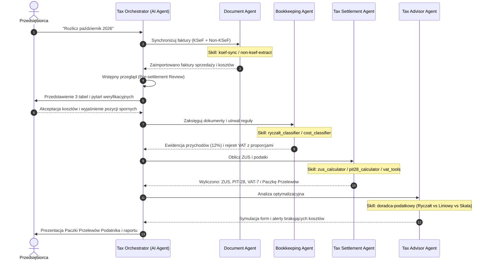

# TaxPilot AI – Workspace Rules, Agent Architecture & Operational Instructions (AGENTS.md)

Ten plik stanowi nadrzędną instrukcję operacyjną dla asystentów AI oraz zespołu autonomicznych agentów pracujących w repozytorium **TaxPilot AI**.
Każdy agent operujący w tym projekcie ma bezwzględny obowiązek stosowania poniższych reguł architektonicznych, standardów, procedur i ról dziedzinowych.

---

## 1. Naczelne Zasady Architektoniczne (Non-Negotiable)

1. **Zero-Hallucination Policy (Separacja Rozumowania od Arytmetyki):**
   * **LLM (Claude / ChatGPT / Gemini / Agent AI):** Odpowiada za rozumienie intencji użytkownika w języku naturalnym, orkiestrację procesu, weryfikację wyjątków z przedsiębiorcą oraz prezentację czytelnych raportów.
   * **Python (`Decimal`):** Wszelkie operacje arytmetyczne (podatki, ZUS, kwoty VAT, odliczenia, sumy) **MUSZĄ** być wykonywane deterministycznie przez dedykowane narzędzia w Pythonie (`src/skills/` oraz `src/level_3_tax_settlement/settlement_service.py`).
   * **ZAKAZ:** Agentowi zabrania się liczenia podatków "w pamięci" LLM. Każda liczba w raporcie musi pochodzić z wykonania kodu Pythona.

2. **Multi-Tenant w oparciu o strukturę katalogów:**
   * Wszystkie dane firmowe, faktury i rozliczenia przechowywane są w:
     `firmy/{NIP-Nazwa}/`
   * Nigdy nie zapisuj faktur ani rozliczeń poza katalogiem danej firmy.

3. **Bezpieczeństwo Danych i KSeF:**
   * Token autoryzacyjny oraz środowisko KSeF (PROD/TEST) odczytywane i zapisywane są bezpośrednio w profilu danej firmy: `firmy/{NIP-Nazwa}/profil.json` (w sekcji `ksef: { srodowisko, token }`).
   * Zmiana tokenu może odbywać się edycją `profil.json` lub komendą CLI: `python -m src.cli set-token --nip {NIP} --token {TOKEN}`.
   * Nigdy nie umieszczaj tokenów ani haseł w kodzie, promptach ani w publicznych repozytoriach gita.

---

## 2. Architektura Zespołu Agentów i Schemat Współpracy

Proces rozliczenia i optymalizacji podatkowej opiera się na orkiestracji wyspecjalizowanych agentów współpracujących w ramach Antigravity IDE:



---

## 3. Katalog Ról i Odpowiedzialności Agentów

### 1. Tax Director / Orchestrator Agent (Główny Koordynator)
* **Model:** Dowolny wiodący model LLM (Claude 3.5 Sonnet / Opus, GPT-4o, Gemini 1.5 Pro).
* **Rola:** Pierwsza linia kontaktu z przedsiębiorcą. Odpowiada za kierowanie przepływem informacji, zarządzanie kontekstem firmy i generowanie finalnych raportów.
* **Zakres wiedzy:**
  * Profil podatnika (`profil.json`).
  * Kalendarz podatkowy (terminy: 20. dzień miesiąca dla PIT/Ryczałtu i ZUS, 25. dzień dla VAT).
* **Zasada działania:**
  * Nie wykonuje obliczeń numerycznych w pamięci.
  * Zleca zadania pod-agentom i narzędziom Python, a następnie syntetyzuje ich wyniki.

### 2. Document Ingestion Agent (Agent Dokumentów)
* **Rola:** Pozyskiwanie, walidacja i bezpieczne archiwizowanie dokumentów finansowych z KSeF oraz źródeł zewnętrznych.
* **Kluczowe moduły i narzędzia:**
  1. `KSeFClient` & `KSeFParser`: Szyfrowanie tokena RSA-OAEP SHA-256 certyfikatem MF, pobieranie paczek faktur XML `FA (2)`/`FA (3)` i zapis w `sprzedaz/ksef/` oraz `koszty/ksef/`.
  2. `NonKSeFExtractor`: Ekstrakcja dokumentów spoza KSeF (PDF, skany, JSON, TXT) dla kosztów i sprzedaży zagranicznej.
  3. `InvoiceStorage`: Organizacja fizycznej symetrycznej struktury dyskowej firmy.
  4. `InvoiceDeduplicator`: Wykrywanie kolizji KSeF vs Non-KSeF (KSeF First), eliminacja duplikatów międzyokresowych (Cross-month) i ochrona przed podwójnym odliczeniem VAT / kosztu.

### 3. Bookkeeping Agent (Agent Księgowy)
* **Rola:** Prawidłowa kwalifikacja podatkowa zdarzeń gospodarczych i prowadzenie ewidencji.
* **Kluczowe moduły i narzędzia:**
  1. `BookkeepingService` / `MonthlyLedger`: Ewidencja Przychodów ryczałtu oraz Rejestr VAT sprzedaży i zakupów.
  2. `audit_invoice_expense` / `RegulyKosztoweFirmy`: Kwalifikacja kosztów (100% firmowy, 50% samochód art. 86a, 0% wydatek prywatny, pozycje do wyjaśnienia).
  3. `RegulySprzedazyFirmy`: Przypisywanie stawek ryczałtu wg NIP kontrahenta i PKWiU.

### 4. Tax Settlement Agent (Agent Podatkowy & ZUS)
* **Rola:** Deterministyczne wyliczenie zobowiązań podatkowo-składkowych w oparciu o kod Pythona.
* **Kluczowe moduły i narzędzia:**
  1. `calculate_zus`: Składki społeczne (emerytalna, rentowa, chorobowa, wypadkowa, FP) oraz składka zdrowotna na ryczałcie (progi do 60k, do 300k, powyżej 300k zł).
  2. `calculate_pit28_advance`: Zaliczka na podatek z odliczeniem składek społecznych i 50% zapłaconej składki zdrowotnej (zaokrąglenie do pełnych zł).
  3. `calculate_vat_settlement`: Bilans VAT-7 (VAT należny - naliczony z uwzględnieniem nadwyżki z poprzedniego okresu).
  4. `SettlementService`: Generowanie kompletnej Paczki Przelewów Podatnika z rachunkami NRS i mikrorachunkiem US.

### 5. Tax Optimization Advisor Agent (Agent Doradca)
* **Rola:** Proaktywne wsparcie decyzyjne i poszukiwanie oszczędności podatkowych dla JDG.
* **Kluczowe moduły i narzędzia:**
  1. `simulate_tax_regimes`: Porównanie form opodatkowania w ujęciu rocznym (Ryczałt vs Podatek Liniowy 19% vs Skala Podatkowa 12%/32%).
  2. `audit_expense_leaks`: Wykrywanie brakujących powtarzalnych faktur kosztowych (hosting, księgowość, telefony, leasing).
  3. Analiza ulg podatkowych (IP-Box 5% dla IT, ulga B+R).

---

## 4. Standardowa Struktura Danych i Katalogów

Wszystkie firmy w systemie podlegają symetrycznej, wielonajemnej strukturze katalogów:

```text
firmy/{NIP-Nazwa}/
├── profil.json                       # Profil podatnika (NIP, forma opodatkowania, ZUS, token i środowisko KSeF)
├── reguly_kosztowe.json              # Nauczone reguły kwalifikacji kosztów
├── reguly_sprzedazy.json             # Reguły stawek ryczałtu dla kontrahentów
├── faktury/                          # Zarchiwizowane faktury
│   └── {ROK}/
│       └── {MIESIAC}/
│           ├── sprzedaz/             # Faktury przychodowe (wystawione przez firmę)
│           │   ├── ksef/             # Faktury sprzedaży pobrane z KSeF ({data}_{nr}.xml/.json)
│           │   ├── non-ksef-raw/     # Oryginalne pliki sprzedaży wrzucone przez użytkownika (PDF, JSON, TXT)
│           │   └── non-ksef-extracted/ # Znormalizowane encje sprzedaży podlegające księgowaniu ({stem}.json)
│           └── koszty/               # Faktury kosztowe wystawione na firmę (zakupy)
│               ├── ksef/             # Faktury kosztowe pobrane z KSeF ({data}_{nr}.xml/.json)
│               ├── non-ksef-raw/     # Oryginalne pliki wrzucone przez użytkownika (PDF, skany, JSON)
│               └── non-ksef-extracted/ # Znormalizowane encje podlegające księgowaniu ({stem}.json)
├── rozliczenia/                      # Archiwum wygenerowanych rozliczeń
│   └── {ROK}/
│       └── {MIESIAC}/
│           ├── rozliczenie.json            # Maszynowy stan rozliczenia
│           ├── rozliczenie.md              # Oficjalny raport z Paczką Przelewów Podatnika
│           ├── ewidencja-przychodow.md     # Ewidencja przychodów za dany miesiąc
│           ├── ewidencja-przychodow-sumy.md# Zestawienie przychodów i odliczeń w ujęciu rocznym (YTD)
│           └── sprawozdanie.md             # Sprawozdanie i audyt podatkowy dokumentów
└── weryfikacje/                      # Archiwum procedury należytej staranności (AML / Sankcje / Biała Lista)
    └── {ROK}/
        └── {MIESIAC}/
            ├── raport-weryfikacji.md       # Zbiorczy raport compliance za dany miesiąc
            ├── raport-weryfikacji.pdf      # Zbiorczy raport w formacie PDF (A4 pejzaż)
            ├── raport-weryfikacji.json     # Maszynowy stan z sumami kryptograficznymi SHA-256
            └── karty/                      # Indywidualne Karty Weryfikacji Kontrahenta (dowód na 5 lat)
                ├── {NIP1}-karta.md
                ├── {NIP1}-karta.pdf        # Oficjalna karta w formacie PDF (A4)
                ├── {NIP1}-raw.json
                └── ...
```

---

## 5. Standard Postępowania: Rozliczanie Miesiąca ("Rozlicz {miesiąc}")

Gdy użytkownik poprosi o rozliczenie danego miesiąca (np. *"Rozlicz październik 2026"*), agent wykonuje następujący 4-krokowy proces:

### Krok 1: Weryfikacja Dokumentów i Ekstrakcja (KSeF + Non-KSeF)
1. **Faktury KSeF:**
   * Sprawdź, czy w katalogach `sprzedaz/ksef/` oraz `koszty/ksef/` znajdują się już faktury z KSeF.
   * Jeśli brak faktur lub użytkownik prosi o pobranie z KSeF:
     ```bash
     python -m src.cli sync --nip {NIP} --rok {ROK} --miesiac {MIESIAC}
     ```
2. **Faktury Non-KSeF (Sprzedaż i Koszty):**
   * Sprawdź obecność plików w `sprzedaz/non-ksef-raw/` oraz `koszty/non-ksef-raw/`.
   * Uruchom ekstrakcję encji do `non-ksef-extracted/`:
     ```bash
     python -m src.cli extract-non-ksef --nip {NIP} --rok {ROK} --miesiac {MIESIAC}
     ```
   *(Moduły `przeglad` oraz `rozlicz` uruchamiają ten krok również automatycznie).*

### Krok 2: Wstępny Przegląd i Akceptacja Dokumentów (Pre-settlement Review)
Zanim zostanie wykonane finalne rozliczenie kosztów i podatków, agent **MUSI** wygenerować i przedstawić przedsiębiorcy zestawienie weryfikacyjne:
```bash
python -m src.cli przeglad --nip {NIP} --rok {ROK} --miesiac {MIESIAC}
```
*(lub za pomocą `PreSettlementReview.build(profile, rok, miesiac)`).*

Agent przedstawia trzy kluczowe tabele:
1. **Tabela Faktur Przychodowych (Sprzedaż):**
   * Wykaz wszystkich faktur sprzedaży idących do księgowania (data, numer, kontrahent, NIP, kwota netto, ryczałt, VAT, brutto, przedmiot sprzedaży, źródło: `🏛️ KSeF` / `📁 Non-KSeF`).
   * **Weryfikacja kompletności:** Przedsiębiorca potwierdza, czy to wszystkie przychody danego miesiąca, czy brakuje jakiejś faktury (np. wystawionej poza KSeF lub oczekującej).
2. **Tabela Faktur Kosztowych (Zakupy) – Do Akceptacji:**
   * Wykaz wszystkich pobranych faktur zakupowych z podsumowaniem kwot, źródła i kwalifikacji podatkowej.
   * **Weryfikacja przynależności:** Przedsiębiorca potwierdza, czy wszystkie te faktury faktycznie należą do jego firmy i dotyczą prowadzonej działalności.
3. **Tabela Pozycji i Faktur do Wyjaśnienia (Human-in-the-Loop):**
   * Wykaz pozycji niejednoznacznych (`DO_WYJASNIENIA`) oraz pozycji wykluczonych jako prywatne (`PRYWATNY_0`).
   * Agent dopytuje przedsiębiorcę o charakter spornych pozycji (np. opłaty za usługi inne w Play – czy firmowe, czy prywatne; potwierdzenie wykluczenia pakietu rodzinnego/TV).
* **Utrwalenie reguły (Learning / Persistence):**
  Po uzyskaniu odpowiedzi agent zapisuje trwałą regułę w:
  `firmy/{NIP}/reguly_kosztowe.json` (za pomocą `python -m src.cli regula ...` lub `learn_cost_rule`).
  W kolejnych miesiącach ta pozycja będzie klasyfikowana automatycznie!

Dopiero po uzyskaniu akceptacji przedsiębiorcy agent przechodzi do Kroku 3.

### Krok 3: Deterministyczne Przeliczenie Zobowiązań
* Uruchom silnik rozliczeniowy:
  ```bash
  python -m src.cli rozlicz --nip {NIP} --rok {ROK} --miesiac {MIESIAC}
  ```
  *(lub w kodzie: `SettlementService.settle_month(profile, rok, miesiac)`).*
* Silnik wyliczy:
  1. Składki ZUS (społeczne + zdrowotna na ryczałcie uwzględniająca przychód narastająco od początku roku).
  2. Zaliczkę na podatek ryczałtowy PIT-28 (odliczenie ZUS i 50% zdrowotnej, zaokrąglenie do pełnych zł).
  3. Bilans VAT-7 (VAT należny - naliczony z przeniesieniem nadwyżki).

### Krok 4: Prezentacja Paczki Przelewów Podatnika
* Zwróć użytkownikowi zwięzłą, czytelną tabelę z 3 przelewami:
  * **ZUS (NRS):** kwota, termin do 20. dnia kolejnego miesiąca,
  * **Urząd Skarbowy (PIT-28):** kwota, termin do 20. dnia,
  * **Urząd Skarbowy (VAT-7):** kwota, termin do 25. dnia.
* Wskaż ścieżki do wygenerowanego pakietu 4 raportów:
  * `rozliczenie.md` (Paczka Przelewów i podsumowanie),
  * `ewidencja-przychodow.md` (oficjalna ewidencja przychodów za dany miesiąc),
  * `ewidencja-przychodow-sumy.md` (zestawienie roczne przychodów, stawek i odliczeń ZUS),
  * `sprawozdanie.md` (szczegółowy audyt dokumentów i czynności księgowych).

---

## 6. Dedykowane Skille Workspace i Standard Implementacji

### A. Skille Proceduralne Workspace (`.agents/skills/`):
1. **`inicjalizacja-firmy`** (`.agents/skills/inicjalizacja-firmy/SKILL.md`):
   * Procedura onboardingu nowej firmy: pobranie danych z rejestrów (Biała Lista MF, CEIDG), rejestracja kodów PKD, instrukcja wygenerowania tokena KSeF i utworzenie struktury katalogów.
2. **`rozlicz-miesiac`** (`.agents/skills/rozlicz-miesiac/SKILL.md`):
   * Procedura pełnego rozliczenia podatkowego miesiąca i wygenerowania przelewów.
3. **`non-ksef-extract`** (`.agents/skills/non-ksef-extract/SKILL.md`):
   * Procedura ekstrakcji i weryfikacji dokumentów kosztowych oraz sprzedaży spoza KSeF (PDF, JSON, skany).
4. **`ksef-sync`** (`.agents/skills/ksef-sync/SKILL.md`):
   * Procedura bezpiecznego połączenia z KSeF 2.0 (szyfrowanie RSA-OAEP SHA-256) i pobrania faktur.
5. **`doradca-podatkowy`** (`.agents/skills/doradca-podatkowy/SKILL.md`):
   * Procedura symulacji form opodatkowania (Ryczałt vs Liniowy vs Skala) oraz audytu brakujących kosztów.
6. **`weryfikacja-kontrahentow`** (`.agents/skills/weryfikacja-kontrahentow/SKILL.md`):
   * Procedura deterministycznej weryfikacji kontrahentów pod kątem AML, sankcji MSWiA i UE, Białej Listy VAT oraz rachunków bankowych z dwupoziomowym cache'owaniem i archiwizacją dowodów na 5 lat w `weryfikacje/{ROK}/{MIESIAC}/`.

### B. Standard Definiowania Narzędzi w Pythonie (`src/skills/`):
Każde narzędzie obliczeniowe implementowane jest jako deterministyczna funkcja Pythona z pełnymi adnotacjami typów, dokumentacją i użyciem typu `Decimal`:

```python
from decimal import Decimal
from typing import Dict, Any

def calculate_pit28_advance(
    sumy_przychodow_wg_stawek: Dict[Decimal, Decimal],
    skladki_spoleczne_do_odliczenia: Decimal,
    skladka_zdrowotna_zaplacona: Decimal,
    rok: str = "2026",
    miesiac: str = "01"
) -> Dict[str, Any]:
    """
    Deterministyczne obliczenie zaliczki na podatek ryczałtowy (PIT-28).
    Wszystkie kwoty operują na typie Decimal, zaokrąglenie zaliczki do pełnych złotych.
    """
    ...
```

---

## 7. Klient Domyślny (Referencyjny)

W przypadku braku wskazania NIP przez użytkownika, domyślnym podmiotem roboczym w poleceniach CLI i skillach jest:
* **NIP:** `7770001122`
* **Nazwa:** `CloudTech Solutions Jan Kowalski`
* **Profil:** `firmy/7770001122-CloudTech_Solutions_Jan_Kowalski/profil.json`
* **Forma:** Ryczałt 12% (IT / Software Development), Płatnik VAT, Pełny ZUS.
