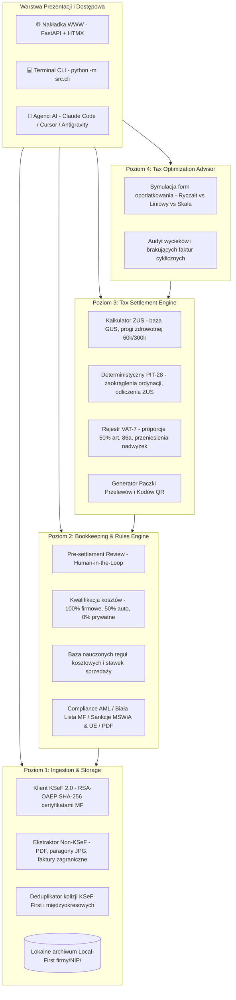

<div align="center">

# 🚀 TaxPilot AI

**Nowoczesny, autonomiczny system podatkowo-księgowy dla jednoosobowej działalności gospodarczej (JDG) w Polsce, oparty na deterministycznym silniku numerycznym Pythona, integracji z Krajowym Systemem e-Faktur (KSeF 2.0) oraz interaktywnej nakładce WWW.**

[](https://github.com/cackoarek/TaxPilot_AI/actions/workflows/ci.yml)
[](https://www.python.org/)
[-orange.svg?style=flat-square)](#-1-naczelna-zasada-zero-hallucination-policy)
[-red.svg?style=flat-square)](#-bezpieczeństwo-ksef-20-i-ochrona-danych)
[](#-nowoczesna-nakładka-www-interfejs-użytkownika)
[-success.svg?style=flat-square&logo=pytest&logoColor=white)](tests/)
[-blueviolet.svg?style=flat-square)](#-elastyczność-llm-oraz-tryb-zero-llm)
[](#-bezpieczeństwo-ksef-20-i-ochrona-danych)
[](LICENSE)
[](https://cackoarek.github.io/TaxPilot_AI/)

<p align="center">
  Automatyczne pobieranie i ekstrakcja faktur (KSeF 2.0 + Non-KSeF PDF/JPG),<br>
  deterministyczne wyliczanie składek ZUS (progi GUS), podatku PIT-28 oraz bilansu VAT-7,<br>
  weryfikacja kontrahentów pod kątem AML, sankcji i Białej Listy MF z dowodami w PDF,<br>
  oraz gotowa Paczka Przelewów z kodami QR dla polskich aplikacji bankowych.
</p>

[🚀 Szybki start](#-szybki-start-w-3-krokach) • [🌐 Przeglądaj Demo](#-przykładowe-widoki-www-i-raporty-na-żywo-github-pages) • [💻 Nakładka WWW](#-nowoczesna-nakładka-www-interfejs-użytkownika) • [🏛️ Architektura](#-architektura-i-4-poziomy-systemu) • [🤖 Scenariusze AI](#-praca-z-agentem-ai-scenariusze-i-komendy) • [⌨️ CLI](#-interfejs-cli-wiersz-poleceń)

</div>

---

## 📄 Przykładowe widoki WWW i raporty na żywo (GitHub Pages)

Możesz przetestować wygenerowane raporty i widoki aplikacji bezpośrednio w przeglądarce bez konieczności instalacji i logowania:

| Kategoria | Widok / Raport | Opis funkcjonalności | Link demo |
|:---|:---|:---|:---|
| 📊 **Pulpit WWW** | **Pulpit & Paczka Przelewów** | Główne KPI, podatki do zapłaty (ZUS, PIT, VAT), kody QR i mikrorachunki | [→ Zobacz](https://cackoarek.github.io/TaxPilot_AI/latest/web_dashboard.html) |
| 📝 **Pulpit WWW** | **Wstępny Przegląd (Krok 2)** | 3 tabele weryfikacyjne, inline-editing kwalifikacji (100%/50%/0%), reguły | [→ Zobacz](https://cackoarek.github.io/TaxPilot_AI/latest/web_przeglad.html) |
| 📑 **Pulpit WWW** | **Księgowanie & Ewidencje** | Ewidencja Przychodów, Rejestr VAT, podsumowanie roczne YTD i audyt | [→ Zobacz](https://cackoarek.github.io/TaxPilot_AI/latest/web_ksiegowanie.html) |
| 📁 **Pulpit WWW** | **Archiwum Faktur (KSeF)** | Przeglądarka faktur z podglądem pozycji i numerów KSeF 2.0 | [→ Zobacz](https://cackoarek.github.io/TaxPilot_AI/latest/web_faktury.html) |
| 🛡️ **Pulpit WWW** | **Compliance AML & Biała Lista** | Weryfikacja MF, sankcje MSWiA/UE, rachunki bankowe i dowody na 5 lat | [→ Zobacz](https://cackoarek.github.io/TaxPilot_AI/latest/web_aml.html) |
| 💡 **Pulpit WWW** | **Doradca Podatkowy** | Symulator form (Ryczałt vs Liniowy vs Skala) i audyt brakujących kosztów | [→ Zobacz](https://cackoarek.github.io/TaxPilot_AI/latest/web_doradca.html) |
| ⚙️ **Pulpit WWW** | **Centrum Ustawień** | Konfiguracja firmy, tokenu KSeF 2.0 (TEST/PROD), ZUS i wyuczonych reguł | [→ Zobacz](https://cackoarek.github.io/TaxPilot_AI/latest/web_ustawienia.html) |
| 🏢 **Pulpit WWW** | **Kreator Onboardingu** | Wieloetapowy kreator wdrażania firmy z pobieraniem danych z rejestrów MF | [→ Zobacz](https://cackoarek.github.io/TaxPilot_AI/latest/web_setup.html) |
| 📑 **Raport PDF** | **Zbiorczy Raport Compliance** | Oficjalny certyfikowany raport w formacie PDF (A4 pejzaż) z SHA-256 | [→ Pobierz PDF](https://cackoarek.github.io/TaxPilot_AI/latest/reports/raport-weryfikacji-2026-10.pdf) |
| 📄 **Raport PDF** | **Karta Kontrahenta (AML)** | Przykładowa Karta Weryfikacji Kontrahenta w formacie PDF (A4 pion) | [→ Pobierz PDF](https://cackoarek.github.io/TaxPilot_AI/latest/reports/5252674797-karta.pdf) |
| 🌐 **Portal** | **Strona Główna Wydań Demo** | Zbiorczy portal wszystkich wydań i wersji demonstracyjnych | [→ Przejdź do portalu](https://cackoarek.github.io/TaxPilot_AI/) |

</div>

---

## 💡 Dlaczego TaxPilot AI?

Tradycyjne programy księgowe bywają skomplikowane i wymagają żmudnego ręcznego wprowadzania danych. Z kolei próby powierzenia rozliczeń bezpośrednio modelom językowym (LLM) kończą się halucynacjami arytmetycznymi. **TaxPilot AI** łączy to, co najlepsze z obu światów:

* 🧠 **Zero-Hallucination Policy (Separacja myślenia od arytmetyki):** LLM interpretuje intencje, czyta opisy pozycji i asystuje przedsiębiorcy. Wszelkie obliczenia numeryczne (podatki, ZUS, kwoty VAT, odliczenia) wykonuje w 100% deterministyczny kod Pythona na typie `Decimal`.
* 🌐 **Nowoczesna Nakładka WWW (Server-Driven UI):** Lekki, błyskawiczny pulpit (FastAPI + Jinja2 + TailwindCSS + HTMX 2.x) działający lokalnie. Zero ciężkich frameworków SPA – natychmiastowe odświeżanie fragmentów stron bez przeładowania.
* 🏛️ **Krajowy System e-Faktur (KSeF 2.0 Ready):** Obsługa środowisk produkcyjnych i testowych Ministerstwa Finansów, bezpieczne szyfrowanie tokenów algorytmem RSA-OAEP SHA-256 oraz parsowanie struktur `FA (2)` i `FA (3)` (ceny netto i brutto).
* 📁 **Obsługa dokumentów spoza KSeF (Non-KSeF):** Automatyczna ekstrakcja dokumentów PDF, skanów paragonów z NIP (JPG) oraz faktur zagranicznych (Google Cloud, AWS, GitHub, Stripe) z wykrywaniem kolizji i duplikatów.
* 📱 **Paczka Przelewów z Kodami QR:** Natychmiastowe generowanie kodów QR zgodnych ze standardem Związku Banków Polskich dla przelewów ZUS (NRS), PIT-28 (mikrorachunek) oraz VAT-7 – opłać podatki smartfonem w mObywatelu lub aplikacji bankowej w kilka sekund!
* 🛡️ **Należyta Staranność & Compliance AML:** Automatyczne sprawdzanie kontrahentów w rejestrach MF (Biała Lista VAT, rachunki bankowe), listach sankcyjnych (MSWiA, UE) oraz generowanie oficjalnych Kart Weryfikacji Kontrahenta (PDF A4) i zbiorczych raportów compliance (PDF A4 pejzaż z sumami kontrolnymi SHA-256) jako dowód na 5 lat.
* ⚖️ **Doradca Podatkowy & Symulator Form:** Porównanie form opodatkowania w czasie rzeczywistym (Ryczałt vs Podatek Liniowy 19% vs Skala Podatkowa 12%/32%) wraz z audytem brakujących kosztów cyklicznych.
* 🔒 **100% Local-First & Multi-Tenancy:** Wszystkie dane, faktury, profile i klucze przechowywane są wyłącznie lokalnie w izolowanych katalogach firmowych `firmy/{NIP-Nazwa}/`. Żadne dane finansowe nie wyciekają do zewnętrznych baz danych.

---

## 🌐 Nowoczesna Nakładka WWW (Interfejs Użytkownika)

Aplikacja posiada kompletny, estetyczny interfejs graficzny uruchamiany w przeglądarce pod adresem `http://localhost:8000`:

| Widok / Moduł WWW | Ścieżka | Opis funkcjonalności |
|:---|:---|:---|
| 📊 **Pulpit Główny** | `/` | Podsumowanie stanu miesiąca, wskaźniki przychodów i kosztów, alerty brakujących faktur, status połączenia AI (Antigravity/Gemini/Claude) oraz szybkie akcje. |
| 🔍 **Wstępny Przegląd (Krok 2)** | `/przeglad` | Weryfikacja dokumentów przed rozliczeniem: 3 tabele (przychody, koszty do akceptacji, pozycje niejednoznaczne), inline-editing HTMX (100% firmowy, 50% samochód art. 86a, 0% wydatek prywatny), zbiorcza kwalifikacja faktur >5 pozycji oraz natychmiastowe utrwalanie reguł firmy. |
| 📚 **Księgowanie & Ewidencje** | `/ksiegowanie` | Ewidencja Przychodów (Ryczałt 12%, 8.5%), Rejestry VAT (sprzedaż i zakupy), Zestawienie Roczne i Sumy (YTD), Sprawozdanie & Audyt (generowane tabele HTML) oraz uruchamianie deterministycznego rozliczenia z obsługą nadwyżki VAT z poprzedniego miesiąca. |
| 💳 **Paczka Przelewów & Kody QR** | `/ksiegowanie?tab=przelewy` | Gotowe dane 3 przelewów podatnika (ZUS NRS, US PIT-28, US VAT-7) wraz z generatorami kodów QR do zeskanowania aplikacją bankową na telefonie. |
| 📁 **Archiwum Faktur** | `/faktury` | Przeglądarka faktur sprzedaży i kosztów podzielona na KSeF oraz Non-KSeF z podglądem szczegółów, pozycji, stawek VAT i dokumentów źródłowych. |
| 🛡️ **Compliance AML & Biała Lista** | `/aml` | Narzędzie weryfikacji należytej staranności: weryfikacja statusu VAT i rachunku bankowego na Białej Liście MF, listy sankcyjne MSWiA i UE, pobieranie Kart Kontrahenta (PDF A4) oraz miesięcznych raportów (PDF A4 pejzaż). |
| 💡 **Doradca Podatkowy** | `/doradca` | Interaktywny symulator opłacalności form opodatkowania (Ryczałt vs Liniowy vs Skala) z uwzględnieniem progów składki zdrowotnej oraz audyt powtarzalnych kosztów (hosting, leasing, telefony). |
| 🤖 **Copilot AI** | Pływający widget | Asystent AI dostępny w rogu każdego ekranu ze streamingiem odpowiedzi na żywo, historią sesji per firma i miesiąc, zintegrowany z silnikiem Antigravity / Gemini / Claude. |
| ⚙️ **Centrum Ustawień** | `/ustawienia` | Konfiguracja parametrów firmy (stawki ryczałtu, ZUS, zasada memoriałowa/kasowa), tokenu i środowiska KSeF 2.0 (TEST/PROD) oraz dostawców AI (Antigravity CLI, Google Gemini, Anthropic Claude). |
| 🏢 **Zarządzanie Firmami** | `/firmy/nowa` | Kreator onboardingu nowej firmy z automatycznym pobraniem danych z rejestrów publicznych MF/CEIDG oraz przełącznik aktywnego podmiotu i okresu. |

---

## 🏛️ Architektura i 4 Poziomy Systemu

TaxPilot AI został zbudowany w oparciu o czystą architekturę warstwową, gwarantującą pełną hermetyczność obliczeń podatkowych:



---

## 🚀 Szybki start w 3 krokach

### Krok 1: Klonowanie repozytorium i środowisko wirtualne
```bash
# 1. Sklonuj repozytorium
git clone https://github.com/cackoarek/TaxPilot_AI.git
cd TaxPilot_AI

# 2. Utwórz i aktywuj środowisko wirtualne venv
python3 -m venv .venv
source .venv/bin/activate  # Na Windows: .venv\Scripts\Activate.ps1

# 3. Zainstaluj zależności
pip install --upgrade pip
pip install -r requirements.txt
```

### Krok 2: Uruchomienie nakładki WWW
```bash
python -m src.web.app
```
Otwórz w przeglądarce adres **`http://localhost:8000`** — uzyskasz dostęp do pełnego pulpitu, kreatora nowej firmy (`/firmy/nowa`), wstępnego przeglądu dokumentów, ewidencji podatkowych oraz Copilota AI.

*(Opcjonalnie możesz uruchomić serwer developerski z auto-reloadem: `uvicorn src.web.app:app --reload`).*

### Krok 3: Wybór trybu pracy (Agent AI, WWW lub Terminal CLI)
Wybierz najwygodniejszy dla siebie sposób interakcji:

* **Wariant A (Nakładka WWW):** Całość procesu (onboarding, import faktur, kwalifikacja, rozliczenie, generowanie przelewów i kodów QR) wykonujesz wizualnie w przeglądarce.
* **Wariant B (Agent AI w terminalu / IDE):** Uruchom `claude` (Claude Code), otwórz projekt w Cursorze / Windsurfie lub `agy` (Antigravity IDE) — asystent odczyta procedury z [AGENTS.md](AGENTS.md) i poprowadzi Cię konwersacyjnie.
* **Wariant C (Terminal CLI):** Wykonuj operacje deterministycznymi poleceniami: `python -m src.cli --help`.

---

## 🤖 Praca z Agentem AI (Scenariusze i komendy)

Możesz rozmawiać z TaxPilotem w naturalnym języku polskim. Asystent współpracuje z dedykowanymi skillami workspace (`.agents/skills/`):

### 1. Onboarding nowej firmy (skill `inicjalizacja-firmy`)
> *"Cześć! Chcę skonfigurować nową firmę. Mój NIP to 7770001122."*
* Agent automatycznie odpyta Białą Listę MF i CEIDG, uzupełni dane rejestrowe, pomoże wygenerować token KSeF 2.0 i utworzy strukturę katalogów.

### 2. Pobieranie faktur (skill `ksef-sync` oraz `non-ksef-extract`)
> *"Pobierz faktury z KSeF za październik 2026"*  
> *"Dodałem fakturę za hosting w PDF do folderu non-ksef-raw. Wyekstrahuj ją"*

### 3. Wstępny Przegląd przed rozliczeniem (skill `rozlicz-miesiac`)
> *"Zrób wstępny przegląd dokumentów za październik 2026"*
* Agent przedstawi 3 przejrzyste tabele (przychody, koszty do akceptacji, pozycje sporne) i dopyta o niejednoznaczne wydatki.

### 4. Nauka reguł firmy (Persistent Rules)
> *"Pozycja 'Internet biurowy' w fakturze Play to 100% koszt firmowy, a pakiet TV to wydatek prywatny"*
* Agent natychmiast zapisze trwałą regułę w `reguly_kosztowe.json`. W kolejnych miesiącach te pozycje zakwalifikują się automatycznie!

### 5. Rozliczenie miesiąca i Paczka Przelewów
> *"Wszystko zatwierdzone. Rozlicz październik 2026 i wygeneruj przelewy"*
* Agent uruchomi deterministyczny silnik Python (`Decimal`), wyliczy ZUS, PIT-28 oraz VAT-7 i wygeneruje Paczkę Przelewów z kodami QR.

### 6. Weryfikacja Kontrahentów (skill `weryfikacja-kontrahentow`)
> *"Sprawdź kontrahenta NIP 5250001090 na Białej Liście i pod kątem sankcji oraz wygeneruj Kartę Kontrahenta PDF"*

### 7. Doradztwo i optymalizacja (skill `doradca-podatkowy`)
> *"Porównaj dla moich rocznych przychodów opłacalność Ryczałtu 12% z Podatkiem Liniowym 19% i Skalą Podatkową"*

---

## 💻 Interfejs CLI (Wiersz Poleceń)

Wszystkie operacje systemu można wykonywać bezpośrednio z wiersza poleceń:

```bash
# Pomoc i lista komend
python -m src.cli --help

# 1. Inicjalizacja nowej firmy (pobranie danych z rejestrów publicznych MF/CEIDG)
python -m src.cli init --nip 7770001122

# 2. Ustawienie tokenu autoryzacyjnego KSeF 2.0
python -m src.cli set-token --nip 7770001122 --token "0261108-TEST-TOKEN|..." --srodowisko TEST

# 3. Synchronizacja faktur z KSeF (miesiąc lub zakres)
python -m src.cli sync --nip 7770001122 --rok 2026 --miesiac 10
python -m src.cli sync-zakres --nip 7770001122 --od 2026-01-01 --do 2026-10-31

# 4. Ekstrakcja dokumentów spoza KSeF (PDF, JPG, TXT)
python -m src.cli extract-non-ksef --nip 7770001122 --rok 2026 --miesiac 10

# 5. Wstępny przegląd dokumentów przed rozliczeniem
python -m src.cli przeglad --nip 7770001122 --rok 2026 --miesiac 10

# 6. Deterministyczne rozliczenie miesiąca i Paczka Przelewów
python -m src.cli rozlicz --nip 7770001122 --rok 2026 --miesiac 10

# 7. Sekwencyjne rozliczenie roczne (z automatycznym przenoszeniem nadwyżek VAT)
python -m src.cli rozlicz-rok --nip 7770001122 --rok 2026 --od 01 --do 10

# 8. Symulacja form opodatkowania (Ryczałt vs Liniowy vs Skala)
python -m src.cli symulacja --nip 7770001122 --dochod 250000 --koszty 30000

# 9. Audyt brakujących faktur cyklicznych
python -m src.cli audyt --nip 7770001122 --rok 2026 --miesiac 10

# 10. Weryfikacja kontrahenta (AML / Sankcje MSWiA i UE / Biała Lista VAT)
python -m src.cli weryfikuj --kontrahent-nip 5250001090 --konto "12102010260000123456789012"

# 11. Miesięczny audyt należytej staranności kontrahentów z raportem PDF
python -m src.cli weryfikuj-miesiac --nip 7770001122 --rok 2026 --miesiac 10
```

---

## 📁 Struktura Danych i Multi-Tenancy

Wszystkie dane każdej firmy są w 100% odseparowane w fizycznej strukturze katalogów:

```text
firmy/{NIP-NazwaFirmy}/
├── profil.json                       # Profil podatnika (NIP, ZUS, forma opodatkowania, token KSeF)
├── reguly_kosztowe.json              # Nauczone reguły kwalifikacji kosztów firmy
├── reguly_sprzedazy.json             # Reguły stawek ryczałtu dla kontrahentów
├── faktury/                          # Archiwum faktur (KSeF i Non-KSeF)
│   └── {ROK}/
│       └── {MIESIAC}/
│           ├── sprzedaz/
│           │   ├── ksef/             # Faktury sprzedaży pobrane z KSeF (.xml i .json)
│           │   ├── non-ksef-raw/     # Oryginalne pliki (PDF, TXT, JSON)
│           │   └── non-ksef-extracted/ # Znormalizowane encje sprzedaży
│           └── koszty/
│               ├── ksef/             # Faktury kosztowe pobrane z KSeF (.xml i .json)
│               ├── non-ksef-raw/     # Skany, paragony z NIP (JPG), faktury zagraniczne
│               └── non-ksef-extracted/ # Znormalizowane encje kosztów
├── rozliczenia/                      # Wygenerowane rozliczenia podatkowe
│   └── {ROK}/
│       └── {MIESIAC}/
│           ├── rozliczenie.json            # Maszynowy stan rozliczenia
│           ├── rozliczenie.md              # Raport z Paczką Przelewów Podatnika
│           ├── ewidencja-przychodow.md     # Oficjalna ewidencja przychodów za miesiąc
│           ├── ewidencja-przychodow-sumy.md# Zestawienie roczne przychodów i odliczeń (YTD)
│           └── sprawozdanie.md             # Sprawozdanie z audytu dokumentów
└── weryfikacje/                      # Archiwum procedury należytej staranności (AML)
    └── {ROK}/
        └── {MIESIAC}/
            ├── raport-weryfikacji.md       # Zbiorczy raport compliance za dany miesiąc
            ├── raport-weryfikacji.pdf      # Zbiorczy raport PDF (A4 pejzaż, SHA-256)
            ├── raport-weryfikacji.json     # Maszynowy stan audytu compliance
            └── karty/                      # Indywidualne Karty Weryfikacji Kontrahenta
                ├── {NIP}-karta.md
                ├── {NIP}-karta.pdf         # Oficjalna karta PDF (A4) – dowód na 5 lat
                └── {NIP}-raw.json
```

W repozytorium znajduje się również śledzony katalog [examples/](examples/) zawierający zanonimizowaną, wzorcową firmę testową z kompletem dokumentów KSeF, Non-KSeF i rozliczeń gotowych do natychmiastowych testów.

---

## 🧪 Testy Jednostkowe i Jakość Kodu

Repozytorium posiada bogaty zestaw 168 deterministycznych testów jednostkowych i integracyjnych pokrywających wszystkie moduły aplikacji:

```bash
# Uruchomienie pełnego zestawu testów
python -m unittest discover tests
```

Zakres testów obejmuje:
* **Deterministyczne wyliczenia ZUS i wskaźniki GUS** ([test_zus_indicators.py](tests/test_zus_indicators.py)).
* **Kwalifikację ryczałtu i PIT-28** ([test_settlement_service.py](tests/test_settlement_service.py)).
* **Rozliczenia VAT-7 i proporcje 50% art. 86a** ([test_vat_aggregator.py](tests/test_vat_aggregator.py)).
* **Bezpieczeństwo i parsowanie KSeF 2.0** ([test_ksef_parser.py](tests/test_ksef_parser.py)).
* **Deduplikację KSeF First i międzyokresową** ([test_invoice_deduplicator.py](tests/test_invoice_deduplicator.py)).
* **Ekstrakcję dokumentów Non-KSeF (PDF, JPG)** ([test_non_ksef_extractor.py](tests/test_non_ksef_extractor.py)).
* **Weryfikację AML, Białą Listę i generowanie PDF** ([test_aml_tools.py](tests/test_aml_tools.py)).
* **Kompletne testy nakładki WWW i tras HTMX** ([test_web_settlement.py](tests/test_web_settlement.py), [test_web_bookkeeping.py](tests/test_web_bookkeeping.py)).

---

## 🔒 Bezpieczeństwo, KSeF 2.0 i Ochrona Danych

* 🛡️ **Prywatność Local-First:** Katalog `firmy/` jest w `.gitignore` – żadne dane firmy, kontrahentów ani kwoty nie trafią do gita ani do chmury.
* 🔐 **Kryptografia KSeF:** Szyfrowanie kluczem publicznym Ministerstwa Finansów algorytmem RSA-OAEP SHA-256 z dopełnieniem MGF1 SHA-256.
* 📜 **Archiwum Należytej Staranności:** Karty Weryfikacji Kontrahentów oraz raporty miesięczne generowane są do formatu PDF i zabezpieczane sumami kontrolnymi SHA-256, stanowiąc twardy dowód w przypadku kontroli skarbowej przez 5 lat.

---

<p align="center">
  Stworzone z myślą o polskich przedsiębiorcach prowadzących jednoosobową działalność gospodarczą 🇵🇱<br/>
  <b>TaxPilot AI – Twoja księgowość pod pełną, bezpieczną kontrolą.</b>
</p>
