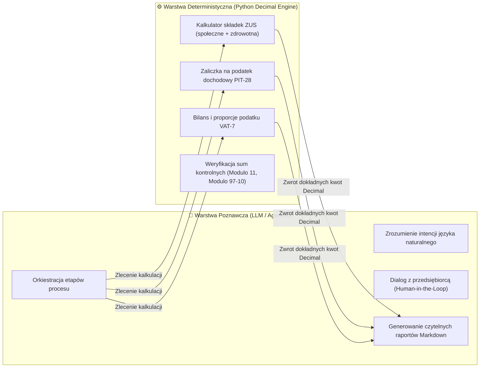
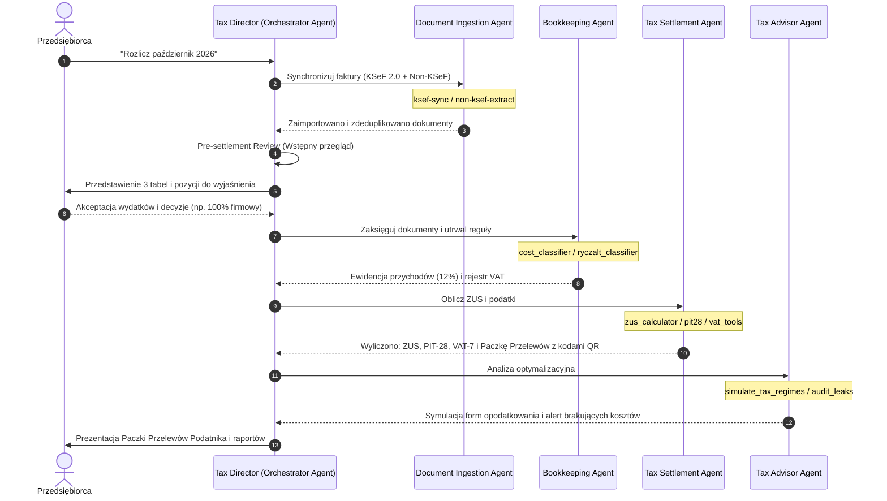

# 🏗️ Rozdział 2: Architektura Systemu & Zespół Agentów

Architektura **TaxPilot AI** została zaprojektowana według restrykcyjnych standardów inżynierii oprogramowania FinTech, w których nie ma miejsca na błędy numeryczne ani halucynacje modeli sztucznej inteligencji.

---

## 1. Naczelne Zasady Architektoniczne

### 1.1. Zero-Hallucination Policy (Separacja Rozumowania od Arytmetyki)
W systemach podatkowo-księgowych halucynacja kwoty podatku lub składki ZUS niesie za sobą bezpośrednie konsekwencje prawno-skarbowe. Dlatego w TaxPilot AI obowiązuje ścisły podział odpowiedzialności:



> [!CAUTION]
> **Zasada nienaruszalna:** Agentowi AI **bezwzględnie zabrania się liczenia podatków w pamięci roboczej LLM**. Każda liczba pojawiająca się w zestawieniach finansowych, Paczce Przelewów czy ewidencji przychodów pochodzi wprost z kodu Pythona operującego na typie `Decimal`.

---

### 1.2. Architektura Multi-Tenant w Strukturze Dyskowej
Wszystkie dane firmowe, faktury, reguły kwalifikacji oraz wygenerowane rozliczenia podlegają izolacji dyskowej w dedykowanych podkatalogach:

```text
firmy/{NIP-Nazwa_Firmy}/
├── profil.json                       # Profil podatnika (NIP, forma opodatkowania, schemat ZUS, KSeF)
├── reguly_kosztowe.json              # Trwale wyuczone reguły kwalifikacji pozycji kosztowych
├── reguly_sprzedazy.json             # Reguły przypisywania stawek ryczałtu dla kontrahentów
├── faktury/                          # Archiwum dokumentów finansowych
│   └── {ROK}/{MIESIAC}/
│       ├── sprzedaz/                 # Przychody (ksef/, non-ksef-raw/, non-ksef-extracted/)
│       └── koszty/                   # Wydatki (ksef/, non-ksef-raw/, non-ksef-extracted/)
├── rozliczenia/                      # Wygenerowane oficjalne raporty
│   └── {ROK}/{MIESIAC}/
│       ├── rozliczenie.json          # Maszynowy stan rozliczenia
│       ├── rozliczenie.md            # Oficjalny raport z Paczką Przelewów
│       ├── ewidencja-przychodow.md   # Ewidencja przychodów za dany miesiąc
│       ├── ewidencja-przychodow-sumy.md # Zestawienie YTD (od początku roku)
│       └── sprawozdanie.md           # Sprawozdanie audytowe z weryfikacji dokumentów
└── weryfikacje/                      # Archiwum procedury należytej staranności (AML / Sankcje / VAT)
    └── {ROK}/{MIESIAC}/
        ├── raport-weryfikacji.md     # Zbiorczy raport compliance za dany miesiąc
        ├── raport-weryfikacji.json   # Maszynowy stan z sumami SHA-256
        └── karty/                    # Indywidualne Karty Weryfikacji Kontrahenta (dowód na 5 lat)
```

---

## 2. Diagram Współpracy Zespołu Agentów

Proces comiesięcznego rozliczenia podatkowego i generowania przelewów opiera się na orkiestracji wyspecjalizowanych agentów:



---

## 3. Role i Odpowiedzialności Agentów

### 1. Tax Director / Orchestrator Agent (Główny Koordynator)
* **Zadanie:** Pierwsza linia kontaktu z przedsiębiorcą. Kieruje przepływem informacji, zarządza stanem okresu rozliczeniowego i syntetyzuje raporty.
* **Zakres wiedzy:** Profil podatnika, kalendarz podatkowy (terminy: 20. dzień miesiąca dla PIT/ZUS, 25. dzień dla VAT).
* **Zasada:** Nie wykonuje kalkulacji w pamięci LLM – deleguje zadania narzędziom Python i pod-agentom.

### 2. Document Ingestion Agent (Agent Dokumentów)
* **Zadanie:** Pozyskiwanie, walidacja i bezpieczna archiwizacja dokumentów.
* **Kluczowe moduły:**
  * `KSeFClient` & `KSeFParser`: Szyfrowanie sesji RSA-OAEP SHA-256 certyfikatem MF, pobieranie faktur XML FA(2)/FA(3).
  * `NonKSeFExtractor`: Natywna ekstrakcja PDF, obrazów oraz JSON (faktury zagraniczne, Google Cloud, AWS, GitHub).
  * `InvoiceDeduplicator`: Wykrywanie kolizji według reguły **KSeF First** (faktura z KSeF ma nadrzędną moc nad plikiem PDF/papierowym).
  * `Auto-Routing`: Automatyczne rozpoznawanie NIP i relokacja omyłkowo upuszczonych faktur (np. sprzedaż wrzucona do folderu kosztów).

### 3. Bookkeeping Agent (Agent Księgowy)
* **Zadanie:** Prawidłowa kwalifikacja podatkowa zdarzeń gospodarczych.
* **Kluczowe moduły:**
  * `CostClassifier`: Klasyfikacja pozycji kosztowych:
    * `FIRMOWY_100`: 100% odliczenia VAT, 100% koszt uzyskania przychodu,
    * `SAMOCHOD_50`: 50% odliczenia VAT (art. 86a ustawy o VAT), 75% kosztu KUP,
    * `PRYWATNY_0`: 0% odliczenia VAT, wydatek prywatny (np. pakiet TV, streaming),
    * `DO_WYJASNIENIA`: Pytanie do przedsiębiorcy w procedurze *Human-in-the-Loop*.
  * `ReczneKwalifikacjeService`: Atomowy zapis decyzji z blokadą plikową (`lock=True`).

### 4. Tax Settlement Agent (Agent Podatkowy & ZUS)
* **Zadanie:** Deterministyczne wyliczenie zobowiązań podatkowych i składek ZUS.
* **Kluczowe moduły:**
  * `calculate_zus`: Składki społeczne (emerytalna, rentowa, wypadkowa, chorobowa, FP) oraz składka zdrowotna ryczałtu (progi: do 60k, do 300k, powyżej 300k zł narastająco YTD).
  * `calculate_pit28_advance`: Zaliczka PIT-28 po odliczeniu składek społecznych i 50% zapłaconej składki zdrowotnej (zaokrąglenie do pełnych złotych).
  * `calculate_vat_settlement`: Bilans VAT-7 z bezpiecznym przeniesieniem nadwyżki z poprzedniego miesiąca (`max(0, nadwyzka)`).
  * `SettlementService`: Generowanie Paczki Przelewów z kodami QR w standardzie ZBP / Elixir.

### 5. Tax Optimization Advisor Agent (Agent Doradca)
* **Zadanie:** Proaktywne wsparcie doradcze i audyt wydatków.
* **Kluczowe moduły:**
  * `simulate_tax_regimes`: Porównanie opłacalności Ryczałtu vs Podatku Liniowego 19% vs Skali Podatkowej 12%/32% w ujęciu rocznym.
  * `audit_expense_leaks`: Wykrywanie brakujących powtarzalnych faktur (księgowość, hosting, telefony, leasing).
  * Analiza ulg podatkowych: IP-Box (5% dla branży IT) oraz ulga B+R.

---

## ⏭️ Kolejny Rozdział

Dowiedz się, jak działa bezpośrednia integracja z Krajowym Systemem e-Faktur:  
👉 [**Przejdź do: 03. KSeF 2.0 & Kryptografia**](03_ksef_i_kryptografia.md)
