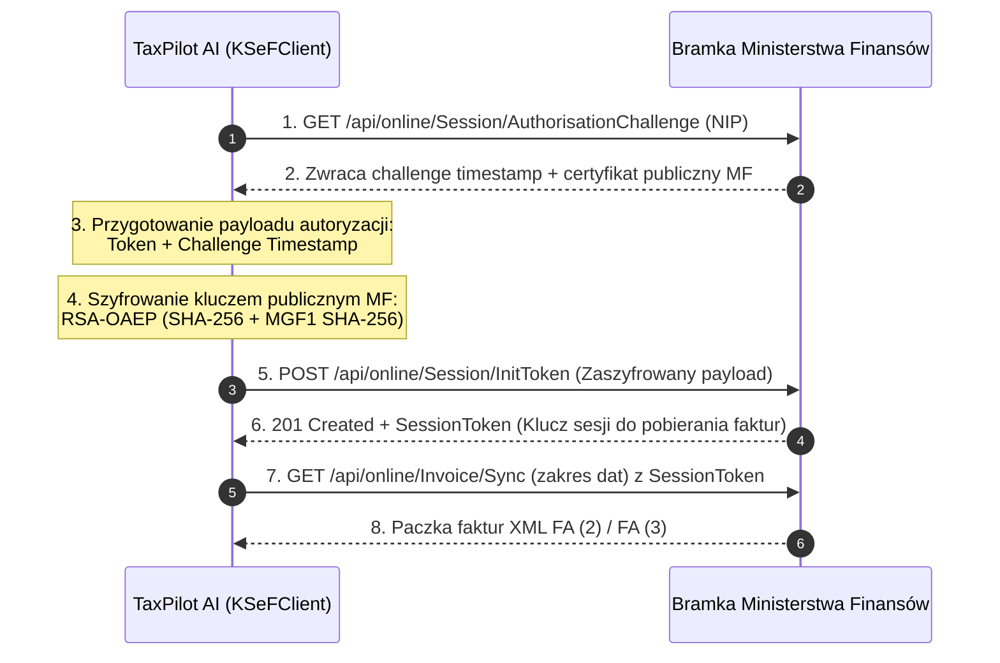
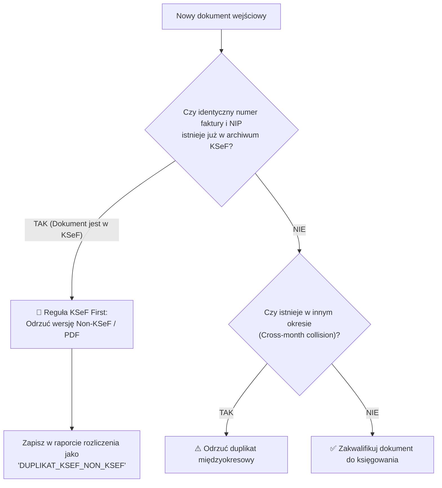

# 🏛️ Rozdział 3: KSeF 2.0 & Kryptografia

TaxPilot AI łączy się bezpośrednio z oficjalnymi bramkami Ministerstwa Finansów bez jakichkolwiek pośredników komercyjnych. Zapewnia to zerowe opłaty transakcyjne, brak ryzyka wycieku danych do podmiotów trzecich oraz pełną zgodność ze standardami rządowymi KSeF 2.0.

---

## 1. Środowiska Krajowego Systemu e-Faktur

System obsługuje dwa środowiska pracy, konfigurowane per firma w `profil.json`:

| Środowisko | Identyfikator | Adres API Ministerstwa Finansów | Zastosowanie |
| :--- | :---: | :--- | :--- |
| **Testowe** | `TEST` | `https://ksef-test.mf.gov.pl/api` | Weryfikacja integracji, testowe tokeny autoryzacyjne, symulacje faktur. |
| **Produkcyjne** | `PROD` | `https://ksef.mf.gov.pl/api` | Oficjalne pobieranie prawnie wiążących faktur ustrukturyzowanych XML. |

Przełączanie środowiska można wykonać w ustawieniach Web UI (`/ustawienia`) lub za pomocą CLI:
```bash
python -m src.cli set-token --nip 7770001122 --token "<TWOJ_TOKEN>" --srodowisko TEST
```

---

## 2. Kryptografia i Procedura Nawiązywania Sesji (Handshake)

Nawiązanie bezpiecznej sesji z KSeF 2.0 opiera się na kryptografii asymetrycznej:



### Specyfikacja Techniczna Szyfrowania:
* **Algorytm:** `RSA/ECB/OAEPWithSHA-256AndMGF1Padding` (RFC 8017 / PKCS #1 v2.2).
* **Maska MGF1:** oparta na funkcji skrótu `SHA-256`.
* **Certyfikaty MF:** Oficjalne klucze publiczne Ministerstwa Finansów pobierane dynamicznie lub dostarczane w archiwum zaufanym.

---

## 3. Podpisy Cyfrowe XAdES-BES (`xades_signer.py`)

Do wysyłki deklaracji i autoryzacji certyfikatami kwalifikowanymi / pieczęciami TaxPilot AI wyposażono w dedykowany moduł podpisu cyfrowego **XAdES-BES** (*XML Advanced Electronic Signatures - Basic Electronic Signature*):

* **Standard:** ETSI EN 319 132-1 (Format podpisu: *Enveloped XML Signature*).
* **Klucze i certyfikaty:** Obsługa standardowych par plików `.crt` / `.pem` oraz kluczy prywatnych `.key` (z opcjonalnym hasłem).
* **Wgrywanie certyfikatów:**
  ```bash
  python -m src.cli set-certs \
    --nip 7770001122 \
    --auth-cert "/sciezka/do/auth.crt" \
    --auth-key "/sciezka/do/auth.key" \
    --auth-password "haslo_klucza" \
    --srodowisko TEST
  ```
  Pliki certyfikatów i kluczy są chronione restrykcyjnymi uprawnieniami systemu plików `0600`.

---

## 4. Inteligentna Deduplikacja Dokumentów (Reguła KSeF First)

W okresie przejściowym w polskich firmach powszechny jest problem dublowania dokumentów: kontrahent wysyła fakturę do KSeF, a równocześnie przesyła mailem tradycyjny plik PDF.

> [!WARNING]
> Zaksięgowanie obu tych dokumentów skutkuje podwójnym odliczeniem podatku VAT oraz zawyżeniem kosztów uzyskania przychodów, co stanowi poważne wykroczenie skarbowe.

### Jak działa `InvoiceDeduplicator` w TaxPilot AI?



1. **Nadrzędna moc dowodowa KSeF:** Dokument pobrany z bramki rządowej zawsze posiada pierwszeństwo przed plikiem PDF lub skanem.
2. **Eliminacja duplikatów międzyokresowych (*Cross-month*):** Jeśli faktura wystawiona pod koniec poprzedniego miesiąca trafi do uploadu w kolejnym miesiącu, moduł deduplikatora wykrywa powtórzenie i zabezpiecza bilans VAT.
3. **Transparentny audyt:** Wszystkie odrzucone duplikaty są jawnie raportowane w plikach `rozliczenie.md` oraz `sprawozdanie.md` wraz z podaniem przyczyny i numeru referencyjnego.

---

## ⏭️ Kolejny Rozdział

Poznaj wszystkie funkcje graficznego interfejsu użytkownika Web UI:  
👉 [**Przejdź do: 04. Przewodnik po Modułach Web UI**](04_przewodnik_uzytkownika.md)
