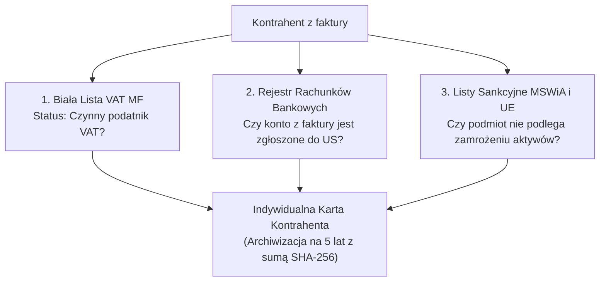

# 🖥️ Rozdział 4: Przewodnik po Modułach Web UI

Interfejs webowy **TaxPilot AI** został zbudowany w technologii **FastAPI + Jinja2 + Tailwind CSS + HTMX + Alpine.js**. Zapewnia on błyskawiczne działanie bez konieczności przeładowywania stron (*Single-Page Feel*) oraz intuicyjny, przejrzysty podział na etapy comiesięcznego rozliczenia.

---

## 1. Pulpit & Przelewy (`/`)

Pulpit stanowi centrum dowodzenia bieżącym okresem rozliczeniowym. Znajdziesz tu syntetyczne podsumowanie finansowe oraz gotową do realizacji **Paczkę Przelewów Podatnika**.

```text
┌────────────────────────────────────────────────────────────────────────┐
│ 📊 PODSUMOWANIE MIESIĄCA: 2026-10                                      │
│ Przychód netto: 25 000,00 zł  │  Koszty KUP: 3 450,00 zł               │
├────────────────────────────────────────────────────────────────────────┤
│ 💳 PACZKA PRZELEWÓW PODATNIKA (Do zlecenia):                           │
│                                                                        │
│ 1. Składki ZUS (NRS):              1 773,96 zł  (termin: do 20.11)      │
│    Rachunek: 84 1010 1023 0000 2613 9510 0000  [Kopiuj]  [📱 Kod QR]  │
│                                                                        │
│ 2. Zaliczka PIT-28 (Ryczałt):      2 811,00 zł  (termin: do 20.11)      │
│    Rachunek: 58 1010 0071 2227 7700 0112 2000  [Kopiuj]  [📱 Kod QR]  │
│                                                                        │
│ 3. Podatek VAT-7:                  4 956,00 zł  (termin: do 25.11)      │
│    Rachunek: 58 1010 0071 2227 7700 0112 2000  [Kopiuj]  [📱 Kod QR]  │
└────────────────────────────────────────────────────────────────────────┘
```

### Kluczowe Funkcjonalności Pulpitu:
* **Generatory Rachunków Skarbowych:**
  * **Mikrorachunek Podatkowy US:** Generowany algorytmicznie na podstawie NIP przedsiębiorcy zgodnie ze wzorem Ministerstwa Finansów (`LK 1010 0071 222{NIP} 0000`) z sumą kontrolną ISO 7064 Modulo 97-10.
  * **Indywidualny Rachunek Składkowy ZUS (NRS):** Generowany z NIP wg specyfikacji ZUS (`LK 1010 1023 0000 2613 9510 0000`).
* **Formatowanie Konta:** Pełna zgodność z normą PN-ISO 13616 w czytelnym układzie 7 grup: `XX XXXX XXXX XXXX XXXX XXXX XXXX`.
* **Kody QR dla Aplikacji Bankowych:** Każdy przelew posiada przycisk wywołujący modal z kodem QR zgodnym ze standardem **ZBP / Elixir**. Wystarczy otworzyć aplikację swojego banku (mBank, PKO BP, Santander, ING, Alior itp.), zeskanować kod aparatem – kwota, tytuł i numer rachunku wypełniają się automatycznie.
* **Kopiowanie do schowka:** Przycisk kopiowania umieszcza w schowku czysty 26-cyfrowy ciąg znaków, akceptowany przez formularze bankowości elektronicznej.
* **Copilot Podatkowy:** Zintegrowany boczny czat AI (`/copilot`), z którym możesz przedyskutować bieżące wątpliwości podatkowe.

---

## 2. Magazyn Faktur & KSeF 2.0 (`/faktury`)

Moduł odpowiada za pozyskanie i uporządkowanie wszystkich dokumentów finansowych za dany miesiąc.

### Funkcjonalności:
1. **Synchronizacja KSeF 2.0:** Jednym kliknięciem pobierasz wszystkie wystawione i otrzymane faktury XML z bramki Ministerstwa Finansów.
2. **Strefa Drag & Drop (Non-KSeF):**
   * Obsługuje pliki PDF, zdjęcia faktur i paragonów (JPG, PNG) oraz pliki JSON/TXT.
   * Dedykowana dla faktur zagranicznych od kontrahentów spoza UE (Google Cloud, AWS, GitHub, OpenAI, Adobe).
3. **Wbudowany Auto-Routing:**
   * Jeśli omyłkowo upuścisz fakturę sprzedaży w kategorii kosztów (lub odwrotnie), system analizuje NIP sprzedawcy/nabywcy i **automatycznie przenosi plik do właściwego katalogu**, informując o relokacji w banerze informacyjnym.
4. **Tabela Faktur z Kolumną „Podgląd”:**
   * Lista wszystkich dokumentów z podziałem na źródło (`🏛️ KSeF` / `📁 Non-KSeF`), sumy netto, VAT, brutto.
   * Kliknięcie przycisku w kolumnie **Podgląd** otwiera modal z podglądem oryginalnej treści dokumentu.

---

## 3. Przegląd i Kwalifikacja Kosztów (`/przeglad`)

Etap weryfikacji przed ostatecznym zaksięgowaniem (*Pre-settlement Review*). Tutaj przedsiębiorca podejmuje decyzje o przynależności wydatków do działalności gospodarczej.

### 3 Tabele Weryfikacyjne:
1. **Faktury Sprzedaży:** Potwierdzenie kompletności przychodów za dany miesiąc.
2. **Faktury Zakupowe (Koszty):** Zbiorcza akceptacja kosztów prowadzenia firmy.
3. **Pozycje do Wyjaśnienia (*Human-in-the-Loop*):**
   * Wydatki niejednoznaczne (np. faktura z marketu z pozycjami biurowymi i spożywczymi, faktury za telekomunikację z pakietem telewizyjnym).
   * Kwalifikacje podatkowe do wyboru:
     * **100% Firmowy (`FIRMOWY_100`):** Pełne odliczenie VAT i 100% KUP.
     * **50% Samochód (`SAMOCHOD_50`):** Zgodnie z art. 86a ustawy o VAT – 50% odliczenia VAT i 75% KUP dla pojazdów użytkowanych w trybie mieszanym.
     * **Prywatny 0% (`PRYWATNY_0`):** Wyłączenie pozycji z rozliczenia firmy (np. Netflix, pakiet TV).
4. **Automatyczne Uczenie się Reguł:**
   * Po wskazaniu kwalifikacji system zapisuje trwałą regułę w `reguly_kosztowe.json`. W kolejnych miesiącach analogiczne pozycje zostaną zakwalifikowane automatycznie!

---

## 4. Compliance AML & Biała Lista VAT (`/aml`)

Moduł realizacji procedury należytej staranności (*Due Diligence*) wymaganej przez Krajową Administrację Skarbową.



* **Odporność na brak sieci:** W przypadku braku Internetu system jawnie informuje o błędzie połączenia i nie zamyka procedury fałszywym wynikiem negatywnym.
* **Archiwizacja Dowodowa:** Generuje Karty Kontrahenta w formacie Markdown i PDF, stanowiące dowód dochowania należytej staranności w przypadku kontroli skarbowej (przechowywane przez 5 lat w `weryfikacje/{ROK}/{MIESIAC}/karty/`).

---

## 5. Księgowanie & Zamknięcie Miesiąca (`/ksiegowanie`)

Finałowy krok procesu rozliczeniowego:
1. **Ewidencja Przychodów:** Wykaz przychodów ryczałtowych z podziałem na stawki (12%, 8.5%, 15% itd.).
2. **Rejestr VAT:** Ewidencja sprzedaży i zakupów z podziałem na odliczenia 100% i 50%.
3. **Zestawienie Narastające YTD:** Monitorowanie rocznych limitów ryczałtu oraz progów składki zdrowotnej ZUS (60 000 zł oraz 300 000 zł).
4. **Zamknięcie Miesiąca:** Zapisanie stanu w `rozliczenie.json` oraz automatyczne przejście do kolejnego okresu podatkowego.

---

## 6. Doradca Podatkowy (`/doradca`)

Moduł symulacji i optymalizacji obciążeń fiskalnych JDG:
* **Porównywarka Form Opodatkowania:** Symulacja rocznego zysku "na rękę" dla Ryczałtu, Podatku Liniowego 19% oraz Skali Podatkowej (12%/32%) przy zadanym poziomie przychodów i kosztów.
* **Audyt Wycieków Kosztowych:** Wykrywanie brakujących faktur cyklicznych (np. zapomniana faktura za telefon komórkowy, hosting lub leasing).

---

## ⏭️ Kolejny Rozdział

Dowiedz się więcej o architekturze bezpieczeństwa i mechanizmach Disaster Recovery:  
👉 [**Przejdź do: 05. Bezpieczeństwo & Disaster Recovery**](05_bezpieczenstwo_i_ops.md)
