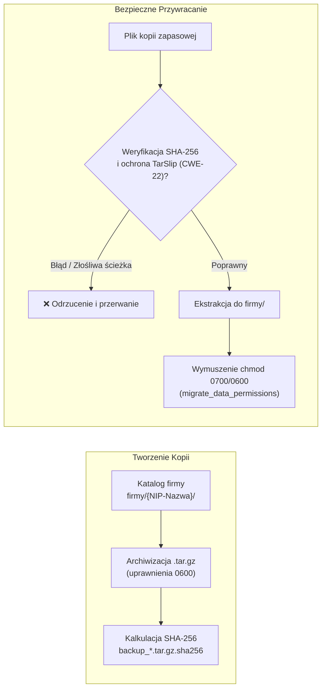

# 🛡️ Rozdział 5: Bezpieczeństwo & Disaster Recovery

Bezpieczeństwo danych finansowych przedsiębiorstwa stanowi fundament architektury **TaxPilot AI**. Niniejszy rozdział opisuje wdrożone mechanizmy obronne (*Defense-in-Depth*) oraz procedury tworzenia i odzyskiwania kopii zapasowych (*Disaster Recovery*).

---

## 1. Standardy Bezpieczeństwa Aplikacji

TaxPilot AI spełnia rygorystyczne wymagania bezpieczeństwa aplikacji internetowych OWASP Top 10:

| ID Reguły | Obszar Zagrożenia | Wdrożony Mechanizm Zabezpieczający |
| :---: | :--- | :--- |
| **SEC-1, SEC-19** | **XSS (CWE-79)** | Deterministyczne kodowanie encji HTML (`html.escape(..., quote=True)`) w dymkach Copilota, raportach Markdown i nagłówkach tabel. |
| **SEC-2, SEC-5** | **Złośliwy Upload** | Inspekcja strumieniowa plików (*magic bytes*), limity rozmiaru (15 MB plik, 50 MB paczka), sanityzacja nazw oraz blokowanie osadzonego kodu JS w PDF (`/JavaScript`, `/Launch`). |
| **SEC-3, SEC-7** | **Brute-Force & Timing** | Stałoczasowa weryfikacja tokenów (`secrets.compare_digest`), in-memory rate limiter per IP na trasie `/login` (maks. 5 prób/min) z opóźnieniem 1.0 s. |
| **SEC-4, SEC-10, PERM-1** | **Uprawnienia Danych** | Wymuszenie `chmod 0700` dla katalogów firmowych oraz `chmod 0600` dla plików `profil.json`, certyfikatów i faktur. Automatyczna migracja uprawnień przy starcie serwera. |
| **SEC-9, SEC-16** | **Open Redirect (CWE-601)** | Restrykcyjna walidacja ścieżek przekierowań (`is_safe_redirect_url`) blokująca obce domeny, protokoły względne (`//evil.com`) i znaki sterujące. |
| **SEC-11, SEC-20** | **CSRF (CWE-352)** | Schemat **Double-Submit Cookie**: ciasteczko `taxpilot_csrf_token` (`SameSite=Lax`, dynamiczny `Secure`), walidacja nagłówka `X-CSRF-Token`, obsługa reverse-proxy (`X-Forwarded-Host`) i blokada protocol downgrade. |
| **SEC-13** | **Szyfrowanie At-Rest** | Symetryczne szyfrowanie tokenów KSeF algorytmem Fernet (`AES-128-CBC` + `HMAC-SHA256`) z derywacją klucza PBKDF2 przy obecności zmiennej `TAXPILOT_ENCRYPTION_KEY`. |
| **SEC-15** | **Nagłówki HTTP** | Middleware wstrzykujący nagłówki: `X-Content-Type-Options: nosniff`, `X-Frame-Options: DENY`, `Referrer-Policy: strict-origin-when-cross-origin` oraz `Content-Security-Policy`. |
| **SEC-17, SEC-18, IO-1** | **Atomowość I/O & Mutex** | Funkcje atomowego zapisu `atomic_write_json`, `atomic_write_bytes` i `atomic_write_text` wykorzystujące unikalne pliki tymczasowe, `fsync`, podmianę `os.replace` i blokady `fcntl.flock`. |
| **SEC-21** | **Poufność Logów** | Filtr `SecretMaskingFilter` deterministycznie maskujący klucze API (Google, OpenAI, Claude), tokeny KSeF, nagłówki Bearer i hasła w konsoli i pliku `taxpilot.log`. |

---

## 2. Maskowanie Danych Poufnych w Logach (`SEC-21`)

W celu wyeliminowania ryzyka przypadkowego wycieku kluczy API lub danych uwierzytelniających do plików dziennika zdarzeń (np. podczas wysyłki zgłoszeń o błędach), system wykorzystuje dedykowany filtr `SecretMaskingFilter`.

Przechwytuje on wszystkie komunikaty logowania oraz ich argumenty i stosuje maskowanie w locie:
* **Google API:** `AIzaSyD...` &rarr; `AIza...[MASKED]`
* **OpenAI API:** `sk-proj...` &rarr; `sk-...[MASKED]`
* **Anthropic Claude:** `sk-ant-api...` &rarr; `sk-ant-...[MASKED]`
* **Nagłówki autoryzacyjne:** `Authorization: Bearer eyJhb...` &rarr; `Authorization: Bearer [MASKED_TOKEN]`
* **Tokeny KSeF:** `"SessionToken": "..."` &rarr; `"SessionToken": "[MASKED_KSEF_TOKEN]"`

---

## 3. Silnik Kopii Zapasowych & Disaster Recovery (`OPS-1`)

Moduł kopii zapasowych ([`src/core/backup.py`](file:///home/acacko/PycharmProjects/TaxPilot_AI/src/core/backup.py)) umożliwia łatwe tworzenie i bezpieczne odzyskiwanie całego środowiska podatnika w przypadku awarii sprzętu, migracji na nowy komputer lub potrzeby długoterminowej archiwizacji.



### 3.1. Tworzenie Kopii Zapasowej (Backup)

Komenda CLI pakuje cały katalog firmy do skompresowanego archiwum `.tar.gz`, pomijając pliki tymczasowe (`.tmp`, `.lock`, cache), nadaje uprawnienia `0600` i generuje plik sumy kontrolnej SHA-256:

```bash
python -m src.cli backup --nip 7770001122
```

Opcjonalnie możesz wskazać własny katalog docelowy (np. zewnętrzny dysk zaszyfrowany):
```bash
python -m src.cli backup --nip 7770001122 --output /mnt/secure_backup/
```

Przykładowy wynik:
```text
Tworzę kopię zapasową danych firmy CloudTech Solutions Jan Kowalski (NIP: 7770001122)...

✅ Kopia zapasowa utworzona pomyślnie!
 * Archiwum:     /home/acacko/PycharmProjects/TaxPilot_AI/firmy/backups/backup_7770001122_20261126_204500.tar.gz
 * Rozmiar:      2 458 912 bajtów
 * Suma SHA-256: /home/acacko/PycharmProjects/TaxPilot_AI/firmy/backups/backup_7770001122_20261126_204500.tar.gz.sha256
```

---

### 3.2. Ochrona Przed Podatnością TarSlip (CWE-22)

Standardowe funkcje rozpakowywania archiwów (np. w starszych implementacjach Pythona) są podatne na atak *Directory Traversal / TarSlip*, gdzie złośliwie spreparowane archiwum zawiera ścieżki względne `../../etc/cron.d/` umożliwiające nadpisanie dowolnych plików w systemie operacyjnym.

> [!IMPORTANT]
> Silnik odzyskiwania TaxPilot AI przed wyodrębnieniem jakiegokolwiek pliku wykonuje pełną inspekcję nagłówków archiwum tar. Jeśli którykolwiek element zawiera ścieżkę bezwzględną lub uciekającą (`..`), operacja jest natychmiast przerywana z wyjątkiem `ValueError`, uniemożliwiając naruszenie integralności systemu.

---

### 3.3. Przywracanie Danych z Kopii Zapasowej (Restore)

Aby odtworzyć firmę z kopii zapasowej na nowej maszynie:

```bash
python -m src.cli restore /sciezka/do/backup_7770001122_20261126_204500.tar.gz
```

Silnik automatycznie:
1. Sprawdzi integralność archiwum i zgodność sumy SHA-256.
2. Zweryfikuje brak zagrożeń TarSlip.
3. Rozpakuje strukturę do katalogu `firmy/`.
4. Nada katalogom uprawnienia `0700`, a plikom `0600`.
5. Załaduje i potwierdzi profil firmy.

---

## ⏭️ Kolejny Rozdział

Zapoznaj się z kompletnym spisem komend wiersza poleceń:  
👉 [**Przejdź do: 06. Podręcznik Poleceń CLI**](06_komendy_cli.md)
