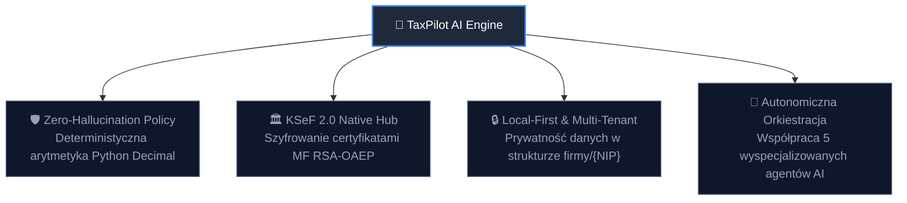

# 📚 TaxPilot AI – Oficjalna Dokumentacja i Baza Wiedzy

Witaj w oficjalnej dokumentacji projektu **TaxPilot AI** – autonomicznego asystenta księgowo-podatkowego dla jednoosobowych działalności gospodarczych (JDG), łączącego orkiestrację agentów AI z deterministyczną arytmetyką podatkową oraz bezpośrednią integracją z Krajowym Systemem e-Faktur (**KSeF 2.0**).

---

## 🧭 Mapa Dokumentacji

Dokumentacja została podzielona na dedykowane, szczegółowe działy tematyczne:

| Rozdział | Tytuł | Zakres tematyczny |
| :---: | :--- | :--- |
| **01** | [**Szybki Start & Wdrożenie**](01_szybki_start.md) | Wymagania, instalacja środowiska, plik `.env`, uruchomienie Web UI / CLI, onboarding nowej firmy. |
| **02** | [**Architektura & Zespół Agentów**](02_architektura_i_agenci.md) | Filozofia *Zero-Hallucination*, struktura wielonajemna (*Multi-Tenant*), diagramy orkiestracji i role agentów. |
| **03** | [**KSeF 2.0 & Kryptografia**](03_ksef_i_kryptografia.md) | Środowiska TEST/PROD, szyfrowanie RSA-OAEP SHA-256, podpisy certyfikatami X.509, deduplikacja *KSeF First*. |
| **04** | [**Przewodnik po Modułach Web UI**](04_przewodnik_uzytkownika.md) | Pulpit i Paczka Przelewów z kodami QR, Magazyn Faktur, Wstępny Przegląd, Compliance AML, Księgowanie. |
| **05** | [**Bezpieczeństwo & Disaster Recovery**](05_bezpieczenstwo_i_ops.md) | Standardy bezpieczeństwa (CSRF Double-Submit, maskowanie logów, ochrona danych), moduł Enterprise Backup & Restore. |
| **06** | [**Podręcznik Poleceń CLI**](06_komendy_cli.md) | Kompletny zestaw komend interfejsu wiersza poleceń z praktycznymi przykładami użycia. |

---

## ⚡ Główne Filary Systemu

> [!NOTE]
> Projekt został zaprojektowany z myślą o pełnej prywatności przedsiębiorcy (*Local-First*). Wszystkie dane firmowe, faktury, reguły podatkowe oraz wygenerowane rozliczenia przechowywane są lokalnie na Twojej maszynie i nie są wysyłane na zewnętrzne serwery, z wyjątkiem bezpośrednich połączeń z oficjalnymi bramkami administracji skarbowej (KSeF, Biała Lista VAT, CEIDG).

---

## 🚀 Następny krok

Zacznij od przewodnika instalacji i pierwszego uruchomienia:  
👉 [**Przejdź do: 01. Szybki Start & Wdrożenie**](01_szybki_start.md)
